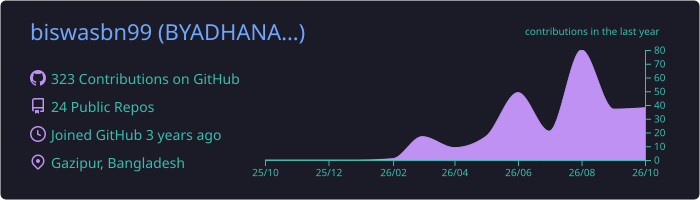
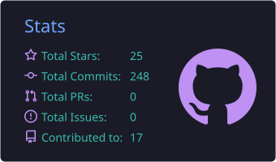
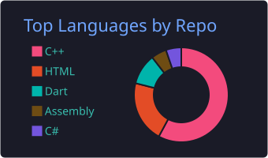
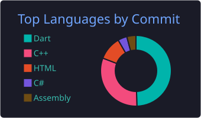
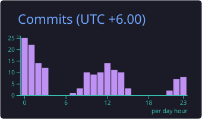

<!-- ============ HEADER BANNER ============ -->

  

  

<!-- ============ VISIBLE CONTACT BADGES ============ -->

  
  

  
  
  

## 👨‍💻 About

Computer Science and Engineering graduate (**CGPA 3.86 / 4.00**, IUBAT) specializing in **cross-platform mobile development with Flutter and Dart**. I build production-style applications featuring authentication, real-time data, REST API integration, payment gateways and AI-assisted features, structured with feature-first architecture and Provider state management.

  
  
  
  

## 🛠️ Tech Stack

### 📱 Mobile Development

  

`Flutter` · `Dart` · `Android & iOS` · `Material 3` · `Responsive UI` · `Navigation & Routing` · `Localization (EN/BN)` · `Light/Dark Themes` · `Lottie Animations`

### 🏗️ Architecture & State Management

`Feature-First Architecture` · `Reusable Widgets` · `Separation of Concerns`

### ☁️ Backend, APIs & Storage

### 🔌 Integrations

### 🌐 Web & Full-Stack (MERN)

  

### 💻 Programming Languages

  

### 🧰 Tools & Practices

  

`Debugging` · `Performance Optimization` · `Version Control` · `Agile Teamwork`

## 📊 GitHub Analytics

<table>
  <tr>
    <td align="center"></td>
    <td align="center"></td>
  </tr>
  <tr>
    <td align="center"></td>
    <td align="center"></td>
  </tr>
</table>

Generated automatically every day from my GitHub activity.

## 📫 Contact

<b>Open to Flutter / Mobile Developer opportunities.</b>

| | |
|:---|:---|
| 📧 **Email** | [byadhanathbiswas.cse@gmail.com](mailto:byadhanathbiswas.cse@gmail.com) |
| 📞 **Phone** | [01746-300498](tel:+8801746300498) |
| 🌐 **Portfolio** | [byadhanath-biswas-portfolio.netlify.app](https://byadhanath-biswas-portfolio.netlify.app/) |
| 💼 **LinkedIn** | [linkedin.com/in/byadhanath-biswas](https://www.linkedin.com/in/byadhanath-biswas/) |
| 📍 **Location** | Gazipur, Bangladesh |

<!-- ============ FOOTER WAVE ============ -->

  

